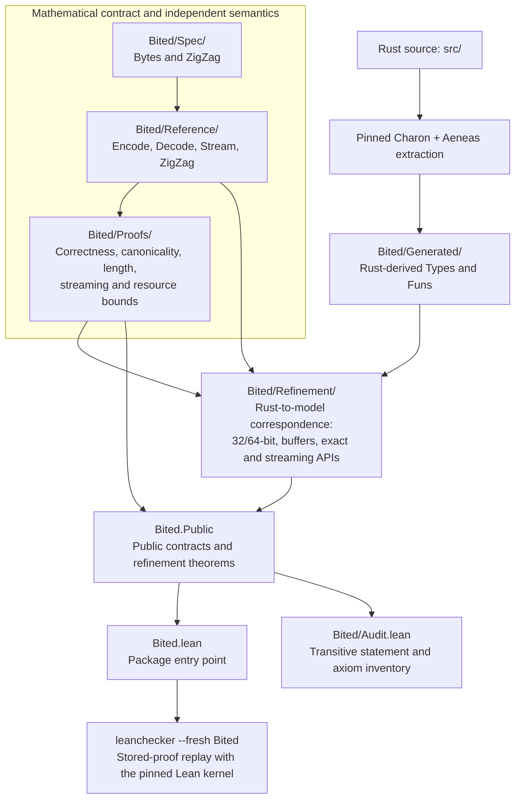
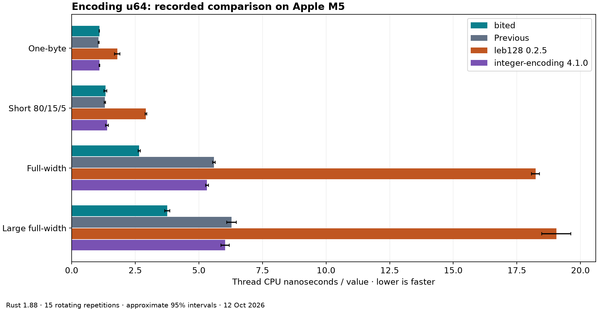
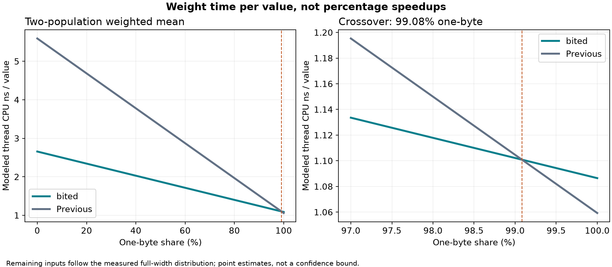

# bited

Rust Varint + ZigZag with a companion Lean 4 proof package. [Version 0.1.0](https://github.com/dmytro-yemelianov/bited/releases/tag/v0.1.0) is published on [crates.io](https://crates.io/crates/bited/0.1.0).

One small `no_std` Rust library for 32/64-bit base-128 varints and ZigZag,
with a corresponding Lean 4 proof package. It has zero runtime dependencies,
forbids unsafe code, and allocates no heap memory.

Read [the bited engineering article](docs/articles/bited.md) for the contract,
proof boundaries, benchmark charts, peer comparison, and weighted workload tradeoff.

The [specification](docs/specification.md) and all 351 original
[conformance vectors](conformance/vectors.json) are preserved byte-for-byte.
The crate provides unsigned/signed encoders, exact lengths, fixed arrays,
atomic caller-buffer output, prefix/exact decoders, and incremental decoders.
Both canonical and explicitly selected bounded-noncanonical policies are supported.

```rust
use bited::{decode_u64, encode_u64, DecodePolicy};

let encoded = encode_u64(300);
assert_eq!(encoded.as_bytes(), &[0xac, 0x02]);
let decoded = decode_u64(encoded.as_bytes(), DecodePolicy::Canonical).unwrap();
assert_eq!((decoded.value, decoded.consumed, decoded.canonical), (300, 2, true));
```

Consumers build with Rust 1.88 or later and need no Lean tools. This is an integer
payload codec; protocol message framing and application length limits belong to callers.

```sh
cargo test --locked
cargo test --locked --release
cargo check --locked --lib --target riscv32imac-unknown-none-elf
```

The Lean package exports `Bited.Public`. It includes mathematical
contracts, independent reference semantics, and Rust-derived refinement theorems
for every explicit core entry point. See [proof coverage](verification/coverage.json),
[proof status](docs/proof-status.md), [resource model](docs/resources.md), and the
[trust boundary](docs/trust-boundary.md). Formal extraction is pinned to
`aarch64-apple-darwin` with 64-bit `usize`; execution also covers 32-bit WASI,
and compilation covers 32-bit bare-metal RISC-V. Source refinement does not
establish compiler or machine-code correctness.

## Lean 4 proof structure

The diagram shows the modeling, proof and export relationships between package
layers. It is an overview, rather than a complete module import graph.



All **18 obligations** are inventoried in [proof coverage](verification/coverage.json).
Generated definitions are regenerated from Rust, never patched by hand. The audit
and fresh replay use the same pinned Lean kernel; replay is not a second kernel
implementation. See [proof status](docs/proof-status.md) and the
[trust boundary](docs/trust-boundary.md).

## Performance charts

Matched measurements on **Apple M5, Rust 1.88.0**, one thread, optimization level 3,
overflow checks enabled and no LTO. Fifteen rotating repetitions compare canonical
valid inputs. Values are mean thread CPU nanoseconds per value; lower is faster.
The chart includes approximate 95% intervals.



| Encode workload | bited (ns/value) | Previous (ns/value) | Paired change in time |
|---|---:|---:|---|
| One-byte | 1.086 | 1.059 | +2.7% |
| Short 80/15/5 | 1.326 | 1.304 | Inconclusive |
| Full-width u64 | 2.657 | 5.593 | −52.5% |
| Large full-width traversal | 3.754 | 6.281 | −40.2% |

The short mixture is 80% one-byte, 15% two-byte and 5% full-width values.
These are encoder measurements: `leb128` was faster at full-width decoding in
the same experiment. Results do not establish rankings on other CPUs or WASM.



The **99.08%** crossover weights measured time for one-byte values and the
full-width workload, using unrounded means. It is a two-population model, not
a threshold for arbitrary two- through ten-byte mixtures. Shortest base-128
length is proved; runtime speed is a separate measured objective.

See the [article](docs/articles/bited.md) for uncertainty, decoder comparisons and
workload interpretation, and [raw results](verification/performance/results.json)
for samples and provenance. Regenerate the charts with `scripts/article-charts.py`.

## Reproduce verification and artifacts

Install Rustup and Elan, then build the exact Charon/Aeneas revisions using the
[upstream instructions](https://github.com/AeneasVerif/aeneas/tree/d119a474f852781f8ae88a85424f2f8ba8407b82#installation--build).
Aeneas is pinned to `d119a474f852781f8ae88a85424f2f8ba8407b82`, with Charon
`798016509139eb51f0d764645f76d068d34ba5f6`. Its `make setup-charon` builds the
matching Charon. The workflow checks revisions, pristine checkouts and binary identity.

```sh
export AENEAS_HOME=/absolute/path/to/pinned/aeneas
rustup toolchain install 1.88.0 --profile minimal --component rustfmt --component clippy
rustup target add riscv32imac-unknown-none-elf wasm32-wasip1 --toolchain 1.88.0
rustup toolchain install nightly-2026-09-17 --component rustc-dev --component rust-src
elan toolchain install leanprover/lean4:v4.31.0
cargo fetch --locked
cargo +nightly-2026-09-17 fetch --locked --manifest-path fuzz/Cargo.toml
lake update
./scripts/verify
```

Install `cargo-fuzz 0.13.1` and the Wasmtime version in
[toolchain-lock.json](verification/toolchain-lock.json). The strict local profile
also pins their executable hashes; a different machine's tool binaries require
an explicitly recorded verification profile, rather than bypassing the checks.
Extraction currently uses an Apple ARM host. Dependency/tool setup uses the network;
subsequent Rust builds use locked offline dependencies. The Lake dependency commits
are checked before the package reproduction step.

The single command runs lint, host debug/release tests, WASI tests, the bare-metal
compile check, source re-extraction, Lean build, transitive axiom audit, fresh-kernel
stored-proof replay, ASan coverage-guided fuzzing, repeated baseline benchmarks,
and both package checks. It fails closed if a required claim or evidence check fails.
`--development` permits an explicitly incomplete coverage profile, without labeling it a release.

Reports are generated in `verification/reports/`. Cargo and Lean archives are placed
in `target/package/`, together with the release verification sidecar. The Cargo archive
is compiled and re-extracted to byte-identical generated Lean. The Lean archive is
rebuilt with fresh project outputs and rechecked, using pristine pinned dependency
cache entries. These are local release artifacts; registry upload is a separate operation.

[scripts/regenerate-model](scripts/regenerate-model) only generates from Rust;
`--check` detects drift without editing generated definitions. The
[benchmarks](docs/benchmarks.md) describe distributions, uncertainty and target resources.
The encoder's shortest base-128 representation is proved. Runtime speed is measured
separately; no fastest-implementation claim is made.

The caller-buffer encoder specializes buffers with at least ten bytes through a
bounded view. Its full buffer contract is covered by Lean correspondence. See
[encoder optimization](docs/optimization.md) for matched speed measurements and
short-input/code-size tradeoffs.

## Installation and examples

Add the published package to your project:

```sh
cargo add bited@0.1.0
```

For a local source checkout, use a path dependency on this directory.

```sh
cargo run --example buffer
cargo run --example stream
cargo run --example deltas
```

Every public Rust item has API documentation. Generate it locally with
`cargo doc --no-deps --open`. See [usage](docs/using.md),
[changelog](CHANGELOG.md), [release notes](docs/releases/0.1.0.md) and
[release workflow](docs/releasing.md). Rust and Lean versions ship together.
